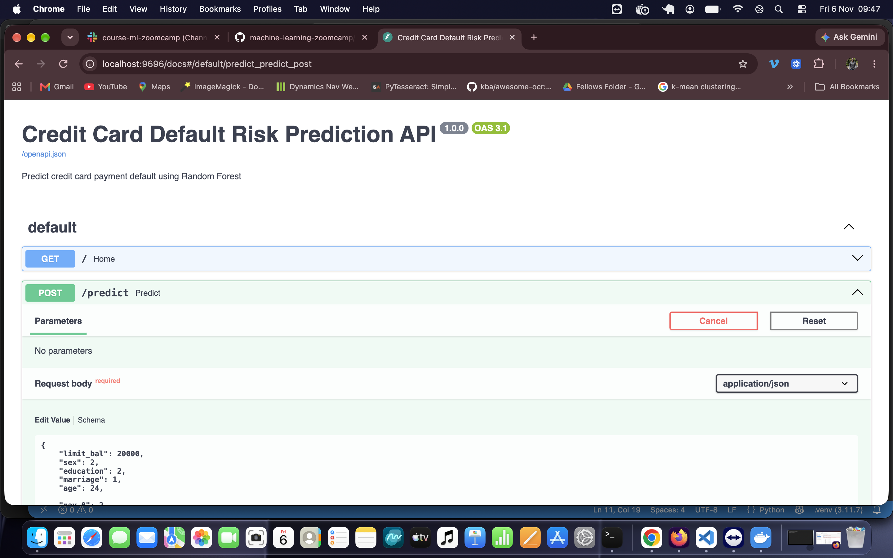
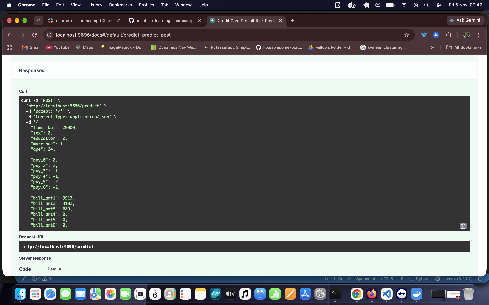
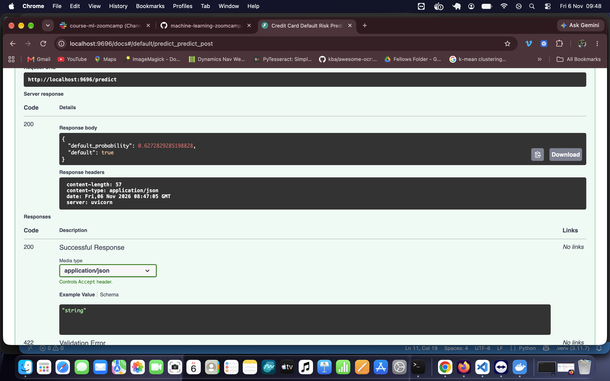

# Credit Card Default Risk Prediction

### ML Zoomcamp 2026 — Midterm Project

## 1. Problem Description

Credit card payment defaults present financial risks to banks and other financial institutions. Predicting which customers are likely to default can help institutions identify potential risks and support informed credit management decisions.

This project develops a machine learning model to predict whether a credit card customer will default on their payment in the following month.

The project covers the complete machine learning workflow:

- Data preparation and exploratory data analysis (EDA)
- Feature importance analysis
- Training and comparing multiple machine learning models
- Hyperparameter tuning and cross-validation
- Final model evaluation
- Model serialization using Pickle
- Building a REST API using FastAPI
- Containerizing and deploying the API locally using Docker

## 2. Dataset

**Dataset:** Default of Credit Card Clients

**Source:** UCI Machine Learning Repository

https://archive.ics.uci.edu/dataset/350/default+of+credit+card+clients

The dataset contains 30,000 credit card customer records from Taiwan.

It includes information about:

- Credit limits
- Demographic characteristics
- Repayment status over six months
- Monthly billing amounts
- Previous payment amounts
- Next-month payment default outcomes

### Target Variable

The target variable is `default`:

- `0`: No default
- `1`: Default

Approximately 22.1% of customers defaulted.

### Dataset Download

Download the dataset from the UCI Machine Learning Repository using the link above.

Extract the Excel file and place it at:

`data/default of credit card clients.xls`

**Note:** This dataset is different from the `CreditScoring.csv` dataset used in ML Zoomcamp Module 6, although both concern credit risk. 

## 3. Exploratory Data Analysis

Exploratory data analysis was performed in `MidTerm Project.ipynb`.

The analysis included:

- Inspecting dataset dimensions and feature types
- Checking missing values and duplicate records
- Examining the target distribution
- Visualizing numerical feature distributions
- Comparing credit limits between default and non-default customers
- Analyzing repayment status
- Investigating feature correlations with the target

### Key Findings

1. Approximately 22.1% of customers defaulted.
2. Customers who defaulted had lower average credit limits.
3. Recent repayment delays were strongly associated with default.
4. Repayment status variables showed some of the strongest correlations with the target.

ROC AUC was selected as the primary model evaluation metric because the target classes are imbalanced.

## 4. Data Preparation

The preprocessing workflow included:

1. Standardizing column names to lowercase with underscores.
2. Renaming `default_payment_next_month` to `default`.
3. Removing the customer identifier `id`.
4. Separating the features and target variable.
5. Converting `sex`, `education`, and `marriage` into categorical strings.
6. Encoding features using `DictVectorizer`.

### Data Splitting

| Dataset | Records | Percentage |
|---|---:|---:|
| Training | 18,000 | 60% |
| Validation | 6,000 | 20% |
| Test | 6,000 | 20% |

For final model training, the training and validation datasets were combined into 24,000 records.

The remaining 6,000 records were reserved for final testing.

## 5. Model Training and Selection

Three classification models were evaluated:

### Logistic Regression

Logistic Regression was trained as the baseline model using scaled features.

**Validation ROC AUC:** 0.726

### Decision Tree Classifier

The Decision Tree was tuned using different values of:

- `max_depth`
- `min_samples_leaf`

**Best validation ROC AUC:** 0.769

### Random Forest Classifier

Random Forest was tuned using:

- `n_estimators`
- `max_depth`
- `min_samples_leaf`

**Best validation ROC AUC:** 0.788

Random Forest was selected because it achieved the strongest validation performance among the evaluated models.

### Selected Hyperparameters

```python
RandomForestClassifier(
    n_estimators=100,
    max_depth=15,
    min_samples_leaf=10,
    random_state=42,
    n_jobs=-1
)
```

## 6. Cross-Validation

Five-fold cross-validation was performed using `KFold`.

| Fold | ROC AUC |
|---|---:|
| 1 | 0.778 |
| 2 | 0.781 |
| 3 | 0.788 |
| 4 | 0.782 |
| 5 | 0.789 |

**Mean ROC AUC:** 0.784

**Standard deviation:** 0.004

The results indicate relatively consistent performance across the five folds.

## 7. Final Model Evaluation

The final Random Forest model was trained on the combined training and validation dataset and evaluated on the held-out test dataset.

| Model / Evaluation | ROC AUC |
|---|---:|
| Logistic Regression (validation) | 0.726 |
| Tuned Decision Tree (validation) | 0.769 |
| Tuned Random Forest (validation) | 0.788 |
| Random Forest (5-fold CV mean) | 0.784 |
| **Final Random Forest (test)** | **0.774** |

The final test ROC AUC of 0.774 indicates better-than-random discrimination between customers who default and those who do not.

## 8. Project Structure

The project directory is organized as follows:

```text
credit-risk-scoring-mlzoomcamp/
├── data/
│   └── default of credit card clients.xls
├── models/
│   └── credit_risk_model.bin
├── screenshots/
│   ├── API_Prediction_1.png
│   ├── API_Prediction_2.png
│   └── API_Prediction_3.png
├── Dockerfile
├── MidTerm Project.ipynb
├── MidTerm Project.py
├── predict.py
├── README.md
├── requirements.txt
├── test_predict.py
└── train.py
```

The local development directory also contains virtual environment files, Python caches, and Jupyter metadata. These are excluded from version control using `.gitignore`.

### File Descriptions

| File | Description |
|---|---|
| `MidTerm Project.ipynb` | Jupyter notebook containing EDA, model training, tuning, cross-validation, and evaluation |
| `MidTerm Project.py` | Python script exported from the Jupyter notebook |
| `train.py` | Standalone script for training and saving the final model |
| `predict.py` | FastAPI application for serving predictions |
| `test_predict.py` | Script for testing the prediction API |
| `credit_risk_model.bin` | Serialized Random Forest model and DictVectorizer |
| `requirements.txt` | Python project dependencies |
| `Dockerfile` | Docker configuration for deploying the prediction service |
| `screenshots/` | Evidence of API functionality |

## 9. Environment Setup

Python 3.11 is recommended. The project was developed using Python 3.11.7.

### Clone the Repository

```bash
git clone <>
cd credit-risk-scoring-mlzoomcamp
```

### Create a Virtual Environment

```bash
python3 -m venv .venv
```

Activate the environment on macOS/Linux:

```bash
source .venv/bin/activate
```

For Windows:

```powershell
.venv\Scripts\activate
```

### Install Dependencies

```bash
python -m pip install -r requirements.txt
```

Ensure the dataset is available in the `data/` directory before training.

## 10. Train the Model

Run:

```bash
python train.py
```

The script:

1. Loads and prepares the dataset.
2. Splits the data into training and test sets.
3. Encodes features using `DictVectorizer`.
4. Trains the selected Random Forest classifier.
5. Evaluates the model on the test dataset.
6. Saves the trained model and vectorizer using Pickle.

The model is saved to:

`models/credit_risk_model.bin`

## 11. Run the FastAPI Prediction Service

Start the API locally:

```bash
python -m uvicorn predict:app --host 0.0.0.0 --port 9696
```

The API will be available at:

http://localhost:9696

### Interactive API Documentation

FastAPI automatically provides Swagger UI:

http://localhost:9696/docs

### Prediction Endpoint

`POST /predict`

The endpoint accepts customer information in JSON format and returns:

- `default_probability`: Predicted probability of default
- `default`: Boolean classification using a threshold of 0.5

### Test the Prediction API

Open another terminal and run:

```bash
python test_predict.py
```

A successful test returned:

```text
HTTP Status: 200
Prediction: {'default_probability': 0.6272829285198829, 'default': True}
```

The example customer has an estimated default probability of approximately 62.73%.

## 12. Docker Deployment

The prediction service is containerized using Docker.

### Build the Docker Image

Ensure Docker Desktop is running.

```bash
docker build -t credit-risk-prediction .
```

### Run the Docker Container

Stop any existing service using port 9696, then run:

```bash
docker run --rm -p 9696:9696 credit-risk-prediction
```

The API will be available at:

http://localhost:9696

Swagger UI:

http://localhost:9696/docs

### Test the Dockerized API

Open another terminal:

```bash
python test_predict.py
```

Expected response:

```text
HTTP Status: 200
Prediction: {'default_probability': 0.6272829285198829, 'default': True}
```

The prediction service was successfully tested locally using Docker.

## 13. Deployment Evidence

The following screenshots document the FastAPI prediction service and API testing.

### API Screenshot 1



### API Screenshot 2



### API Screenshot 3



## 14. Technologies Used

- Python 3.11
- pandas
- NumPy
- scikit-learn
- DictVectorizer
- Logistic Regression
- Decision Tree
- Random Forest
- Pickle
- FastAPI
- Pydantic
- Uvicorn
- Docker
- Jupyter Notebook

## 15. Limitations and Future Improvements

- The dataset is historical and may not represent current credit card customers.
- The model's classification threshold has not been optimized for specific business costs.
- Further fairness analysis is necessary because demographic variables are included.
- Monitoring and retraining would be required for production deployment.
- The model is intended for educational purposes rather than automated real-world credit decisions.

## 16. Author

**Jude Ezeh**

ML Zoomcamp 2026 Midterm Project
